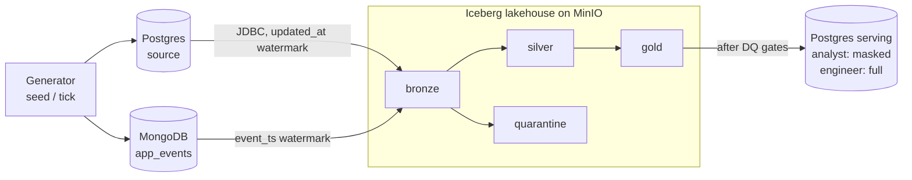

# LedgerLake

A batch lakehouse for a fictional Malaysian consumer fintech app, built to run on one laptop:
- synthetic operational data in **Postgres** and app events in **MongoDB**;
- extracted incrementally into **Apache Iceberg** tables on **MinIO**;
- transformed with **PySpark** (bronze → silver → gold) and checked by a data-quality gate;
- orchestrated by **Airflow**;
- published to a **Postgres serving database** where an `analyst` role can't see personal data.

Everything is pinned, synthetic and reproducible. The specification is [docs/SPEC.md](docs/SPEC.md), and the block-by-block build log with every measurement is [docs/PROGRESS.md](docs/PROGRESS.md).

## Architecture



Airflow DAG `ledgerlake_daily`: `generate_tick → extract_bronze → silver → dq_silver → gold → dq_gold → publish`. Detailed diagrams are in [docs/architecture.md](docs/architecture.md).

## What it demonstrates

Features are mapped to the skills listed in SPEC §1.

| Skill | Where to see it |
|---|---|
| Apache Iceberg | JDBC catalog on Postgres; MERGE INTO upserts; partition overwrite; **schema evolution** (`make demo-schema-evolution`); **time travel** for audit (`make demo-time-travel`); compaction and snapshot expiry (`make maintenance`) |
| Spark | PySpark transformations as pure, unit-tested functions: `jobs/silver/transforms.py`, `jobs/gold/transforms.py` |
| Airflow | `dags/ledgerlake_daily.py`: business-date scheduling, retries, failure callback, DQ gate stops downstream tasks |
| SQL and NoSQL sources | Incremental extracts from Postgres (`updated_at`) and MongoDB (`event_ts`) with idempotent watermarks ([ADR 004](docs/decisions/004-incremental-extract-watermarks.md)) |
| Data quality | Quarantine with failure reasons; 39 silver checks (including a per-run count of every injected defect type) and 20 gold checks; `error` vs `warn` severity; mart-to-silver reconciliation; results in `ops.dq_results` |
| Data governance and access control | PII hashed in silver and isolated in `customers_pii`; `analyst` / `engineer` roles; masked view; 30-test access proof ([docs/access_control.md](docs/access_control.md)) |
| Analytics | Streamlit dashboard of the marts at http://localhost:8501, reading as the least-privileged `analyst` role ([ADR 016](docs/decisions/016-backfill-and-dashboard.md)) |
| Documentation | [Architecture](docs/architecture.md), [data dictionary](docs/data_dictionary.md), [runbook](docs/runbook.md), [16 ADRs](docs/decisions/README.md) |
| Reproducibility | Pinned images, JARs (SHA-256) and packages; deterministic generator (same fingerprint on every seed); CI ([.github/workflows/ci.yml](.github/workflows/ci.yml)) |

## Prerequisites
- **Docker Desktop.** Apple Silicon and x86 both work. In **Settings → Resources**, set **Memory to about 8 GB**.
- **The `docker` command on your PATH.** Check with `docker version`. If it isn't found, add `/Applications/Docker.app/Contents/Resources/bin` to your PATH, or enable Docker Desktop's CLI tools option.
- **`make`** (included with macOS Command Line Tools) and **`git`**.
- **About 8 GB of free disk** for images and data.
- **Free host ports** 5432, 8080, 9000, 9001 and 27017. To use others, edit them in `.env` after the first `make up`.

## Quick start
From a fresh clone:
```bash
make up                       # builds the Airflow image, starts everything, creates .env from .env.example
make smoke                    # Iceberg smoke test: create, write, read a table on MinIO
make seed                     # 60 days of synthetic source data (2026-08-01 to 2026-09-29)
make run date=2026-09-29      # full pipeline for one business date (first run = initial load)
make run date=2026-09-30      # next day: tick, bronze, silver, DQ, gold, DQ, publish
make access-test              # logs in as analyst and engineer; proves who can read what
make demo                     # Iceberg time-travel audit + schema-evolution demo
make maintenance              # compact files, expire old snapshots; logs file counts before/after
```
- **Change the placeholder passwords** in `.env` before sharing anything.
- **Airflow UI:** http://localhost:8080 (no login; bound to localhost only).
- **MinIO console:** http://localhost:9001.
- **Serving database:** `psql -h localhost -U analyst serving`.
- **Dashboard:** http://localhost:8501, a one-page view of the marts. It reads the serving database as `analyst`, so it only sees masked customer data.
- **More days:** `make backfill from=2026-10-01 to=2026-10-07` runs the pipeline for each date in order.

**From VS Code:** open the folder and use **Terminal → Run Task…**, then pick a `LedgerLake: …` task. Tasks include start, run a date (it asks for the date), backfill, demos, access test, maintenance, tests and open the dashboard. **Cmd+Shift+B** starts everything. The tasks add Docker Desktop's CLI to the PATH themselves. Output appears in VS Code's terminal panel; results appear in the dashboard and Airflow UI.

To stop, run `make down`, which keeps the data. `make clean` deletes all data volumes and asks first. Day-to-day operations, re-runs, backfills and troubleshooting are in the [runbook](docs/runbook.md).

## Measured results
Every figure below was measured, not estimated. The quick start figures come from a **fresh copy of this repository (no `.env`) following only the steps above**, on a MacBook Air (Apple Silicon, Docker Desktop with 8 GB, 8 CPUs), on 2026-10-26. The full log of every block is in [docs/PROGRESS.md](docs/PROGRESS.md).

**Quick start timings**

| Step | Result | Wall time |
|---|---|---|
| `make up` | all services healthy | 37 s with cached image layers; **491 s** for the first-ever build (image downloads plus a 4.38 GB image) |
| `make smoke` | `SMOKE TEST PASSED` (Spark 3.5.9, Iceberg 1.10.2, Java 17.0.20) | 19 s |
| `make seed` | 2,000 customers, 99,897 transactions, 50,007 events; fingerprint `10236ace…` (identical on every seed) | 15 s |
| `make run date=2026-09-29` | initial load; 7/7 tasks success | 178 s |
| `make run date=2026-09-30` | incremental day; 7/7 tasks success | 171 s |
| `make access-test` | 30/30 passed | 1 s |
| `make demo` | time-travel audit and schema evolution | 24 s |
| `make maintenance` | 26 tables; physical data files 292 → 289 | 49 s |

**Pipeline (after the two days above)**

| Measure | Value |
|---|---|
| Silver rows: transactions / customers / app events | 99,293 / 2,005 / 50,603 |
| Gold: fact rows / `mart_daily_spend` / `mart_customer_features` | 99,293 / 610 / 3,840 |
| Quarantined transaction keys by reason | duplicate 600, unknown category 400, negative amount 420, null amount 399, orphan account 374, plus 99 late-update audit rows |
| Injected vs quarantined defects (D2-AM check) | equal for every defect type |
| DQ per run | 32 silver and 20 gold checks in the fresh run, all passed both days; mart reconciliation `mismatched_groups=0`. The 7 per-defect-type checks came afterwards, giving 39 silver checks. |
| Defect counts in `ops.dq_results` (2026-09-29 run) | duplicate 584, negative amount 416, null amount 397, unknown category 395, orphan account 371, duplicate events 253. Equal to the generator's injected counts, and to a direct count of the quarantine tables |
| Incremental-day task durations | extract_bronze 18.4 s, silver 43.3 s, dq_silver 24.3 s, gold 23.4 s, dq_gold 19.2 s, publish 7.6 s |
| Re-running a date | all 26 tables have identical row counts (D2-EVE); silver and gold commit no new snapshot (ADR 011) |
| Time-travel audit, 2026-09-29 | completed spend 91,960.60 MYR as first reported, against 95,201.51 MYR now: +3,240.91 from 99 late status changes |
| Data files written per daily run | 1,074 before the write-efficiency change, 57 after (ADR 011) |
| A failing `error` DQ check (simulated) | `dq_silver` failed; `gold` and `dq_gold` `upstream_failed`; failure logged by the callback (D2-EVE, before `publish` was added) |
| Tests | CI stand-in (clean container): ruff clean, 69 passed and 30 skipped; container 43 passed; access 30 passed |

## Make targets
| Target | What it does |
|---|---|
| `make up` / `make down` / `make clean` | Start (build and wait for healthy) / stop (keep data) / stop and **delete all data** (asks first) |
| `make ps` / `make logs [s=airflow]` | Service status / follow logs |
| `make smoke` | Iceberg smoke test through the JDBC catalog on MinIO |
| `make seed` / `make tick date=D` | Rebuild the 60-day source history / add one day (skipped if already generated) |
| `make run date=D` | Run the whole `ledgerlake_daily` DAG for business date D (idempotent) |
| `make backfill from=D1 to=D2` | Run the DAG for every business date in the range, in order; stops at the first failure |
| `make bronze date=D`, `make silver date=D`, `make gold date=D`, `make publish date=D` | Run one layer by hand (in that order) |
| `make dq layer=silver\|gold date=D` | Run a DQ suite; exits 1 on an `error` failure; results in `lake.ops.dq_results` |
| `make dq-gate-demo date=D` | The DAG with a simulated defect (in memory only): `dq_silver` fails, downstream `upstream_failed` |
| `make silver-report` | Quarantine reasons, PII column layout, schema-evolution evidence |
| `make access-test` | 30 checks of what `analyst` and `engineer` can and cannot read |
| `make demo` / `make demo-time-travel [date=D]` / `make demo-schema-evolution` | Iceberg demos |
| `make maintenance [retain=5]` | Compaction, manifest rewrite and snapshot expiry; before/after file counts in `lake.ops.maintenance_log` |
| `make reset-lake` | Drop every lake table (asks first) |
| `make test` / `make lint` | Local unit tests / ruff (`pip install -r requirements-dev.txt`) |
| `make test-container` | Spark and DAG tests inside the Airflow container |

## How it works (short)
- **Synthetic sources** (`generator/`): about 2,000 customers, 100k transactions and 50k app events.
  - About 2.2% of transactions carry a deliberate defect: duplicate, null or negative amount, unknown category, or orphan account.
  - Late-arriving settlements, and a schema drift on 2026-09-14 (`referral_source`).
  - The generator is deterministic ([ADR 003](docs/decisions/003-synthetic-generator.md)).
- **Bronze:** raw rows plus ingestion metadata, partitioned by business date. The extract window starts at the high-water mark of earlier partitions, so re-runs are exact ([ADR 004](docs/decisions/004-incremental-extract-watermarks.md)).
- **Silver:**
  - validation rules send failing rows to `quarantine.*` with a reason;
  - deduplicates on the business key;
  - converts timestamps from Malaysia time to UTC;
  - email and phone become salted SHA-256 hashes, and date of birth an age band;
  - names and contacts stay only in `silver.customers_pii`;
  - `referral_source` is added to `silver.app_events` by Iceberg schema evolution without rewriting old files ([ADR 005](docs/decisions/005-silver-quarantine-and-pii.md)).
- **Gold:**
  - `fact_transactions` (partitioned by day) and `dim_customer` (SCD1) are upserted with MERGE INTO, sending only changed rows ([ADR 011](docs/decisions/011-write-efficiency.md));
  - plus `dim_date`;
  - three marts: daily spend, advance-repayment cohorts, customer features ([ADR 007](docs/decisions/007-gold-model-and-reconciliation.md)).
- **Data quality:** `quality/` runs after silver and after gold. A failed `error` check stops downstream tasks; `warn` only logs. Gold marts are reconciled with silver group by group ([ADR 006](docs/decisions/006-data-quality-module.md)).
- **Serving:** `publish` replaces the marts and `customer_profile` in one Postgres transaction. `analyst` reads the marts and a masked view (`S***`); `engineer` reads everything; neither can write ([ADR 009](docs/decisions/009-serving-and-access-control.md)).
- **Operations:** every task attempt is logged in `lake.ops.pipeline_runs` ([ADR 008](docs/decisions/008-airflow-orchestration.md)). Maintenance and time travel are covered in [ADR 010](docs/decisions/010-time-travel-and-maintenance.md).

## Project layout
```
dags/            Airflow DAG (wiring only)
generator/       synthetic source data (seed / tick)
jobs/            extract, bronze, silver, gold, publish, demo, maintenance, common helpers
quality/         DQ checks, suites, severity gate, mart reconciliation
serving/         serving SQL: tables, masked view, roles and grants
docker/          Airflow image, Postgres and MongoDB init scripts
tests/           unit/, spark/, dags/, integration/
docs/            SPEC, PROGRESS, architecture, data dictionary, runbook, access control, decisions/
```

## Tests and CI
| Suite | Runs | Covers |
|---|---|---|
| `tests/unit` | locally (`make test`), CI | generator, extract helpers, DQ gate, serving contract |
| `tests/spark` | container (`make test-container`), CI | every transformation, DQ checks, reconciliation, MERGE change detection |
| `tests/dags` | container, CI | DAG imports, task order, retries, callbacks, business date |
| `tests/integration` | after a publish (`make access-test`) | serving access for each role |

GitHub Actions runs a ruff lint job and a test job on every push. The test job uses Python 3.11, Temurin 17, and the same pinned Airflow/PySpark versions as the image. Pre-commit (`pre-commit install`) runs ruff and file-hygiene hooks ([ADR 012](docs/decisions/012-ci-and-test-layers.md)).

## Notes
- All data is synthetic. Emails use reserved `example.*` domains. Secrets live in `.env`, which is git-ignored.
- Postgres and MongoDB init scripts run only on empty volumes. Use `make clean` to re-initialise.
- Moving to AWS (S3, Glue catalog, EMR or Glue jobs, MWAA, RDS) is a configuration change, described in [ADR 013](docs/decisions/013-minio-and-aws-migration-path.md).
