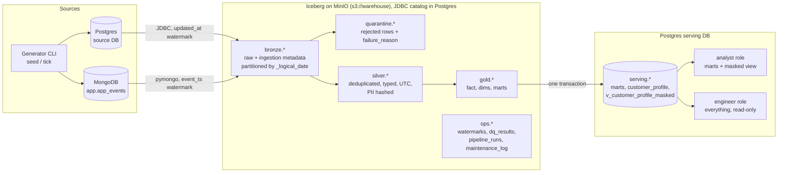
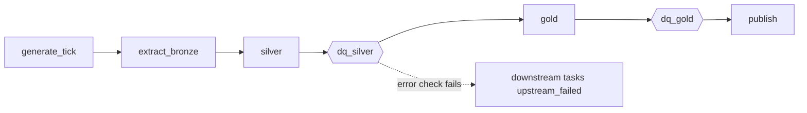
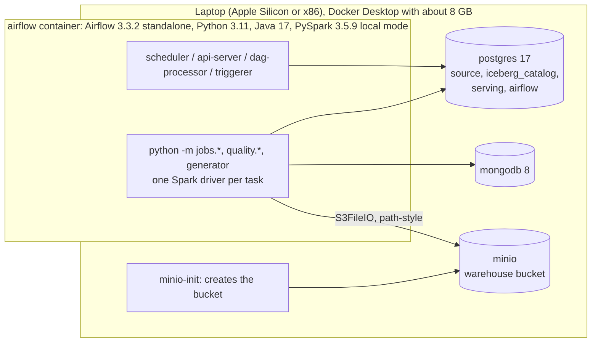

# LedgerLake architecture

LedgerLake is a batch lakehouse for a fictional Malaysian consumer fintech app. Everything runs on one laptop with Docker Compose.

## Data flow

## Orchestration: `ledgerlake_daily`

- **Business date:** every task processes one Malaysia business date. It comes from the `business_date` param, or the data interval of a midnight `Asia/Kuala_Lumpur` schedule.
- **Idempotent:** every task is idempotent for its date.
- **Retries:** build tasks retry twice; DQ tasks never retry.
- **Run log:** each attempt writes a row to `ops.pipeline_runs`. Jobs write success rows, and failure and retry callbacks write the rest.

| Step | What happens | Idempotency mechanism |
|---|---|---|
| generate_tick | One more day of synthetic source data | `source.generator_log`: a generated day is skipped |
| extract_bronze | 5 entities read with `watermark_low < updated_at/event_ts < end of day` | Lower bound comes from earlier bronze partitions; partition D is overwritten |
| silver | Validate, deduplicate, audit late updates, conform, MERGE | Only new or newer rows are merged; quarantine partition D is overwritten |
| dq_silver | 39 checks (including one count per injected defect type) → `ops.dq_results`; exits 1 on an `error` failure | Rows for the run id are replaced |
| gold | dims and fact via MERGE; marts rebuilt | Changed-row MERGE; marts are deterministic |
| dq_gold | 20 checks, including freshness and mart-vs-silver reconciliation | Same as dq_silver |
| publish | TRUNCATE and INSERT of 4 serving tables in one transaction; SQL re-applied | Identical tables on re-run |

## Runtime

- **Spark runs in local mode inside the Airflow container.** There's no cluster. The JARs (Iceberg runtime, Iceberg AWS bundle, Postgres JDBC driver) are baked into the image and SHA-256 verified.
- **The Iceberg catalog is a JDBC catalog** stored in the Postgres `iceberg_catalog` database. Table data and metadata files live in MinIO.
- **Ports bind to `127.0.0.1` only.** Secrets come from `.env`, which is git-ignored.

## Layers

| Layer | Namespace | Grain and contents | Write pattern |
|---|---|---|---|
| Bronze | `lake.bronze` | Source rows as extracted, plus `_ingested_at`, `_source`, `_batch_id`, `_logical_date` | Overwrite partition `_logical_date = D` |
| Quarantine | `lake.quarantine` | Rejected or superseded bronze rows, plus `failure_reason` | Overwrite partition `_quarantine_date = D` |
| Silver | `lake.silver` | One row per business key; UTC timestamps; email and phone hashed; PII only in `customers_pii` | MERGE (newer `updated_at` wins); `transactions` is merge-on-read; events append-only |
| Gold | `lake.gold` | `fact_transactions` (by `days(txn_ts)`), `dim_customer` (SCD1), `dim_date`, 3 marts | MERGE for fact and dims; marts rebuilt |
| Ops | `lake.ops` | Watermarks, DQ results, run log, maintenance log | Append or MERGE |
| Serving | Postgres `serving.*` | Marts, `customer_profile`, masked view | One-transaction TRUNCATE and INSERT |

Column-level detail is in the [data dictionary](data_dictionary.md), operations are in the [runbook](runbook.md), and access rules are in [access_control.md](access_control.md).
